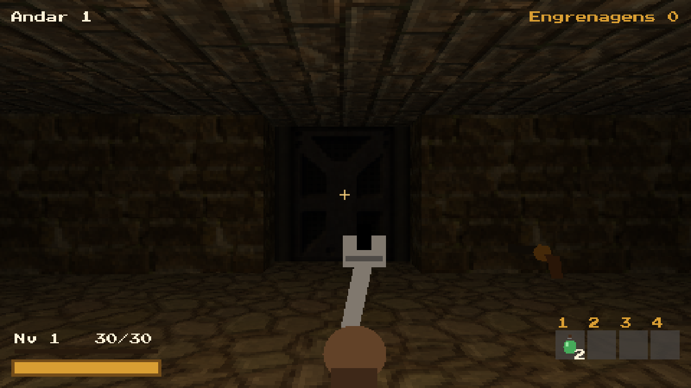
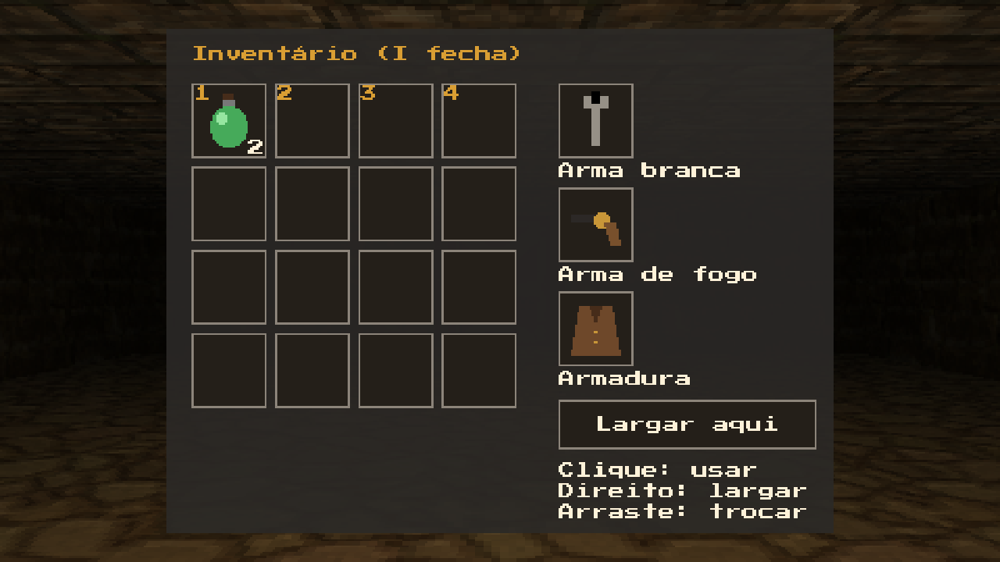

# Abaixo da Cidade de Latão

Um roguelike de masmorra em primeira pessoa e em tempo real, no espírito de *The Elder Scrolls: Arena* e *Doom*,
com tema **steampunk**: túneis de esgoto, fábricas e minas sob uma cidade vitoriana movida a vapor, cheios de
autômatos que perderam o juízo. Cada descida é diferente, a morte é permanente e o placar guarda as 10 melhores.



## Jogar (Windows 10/11, 64 bits)

1. Baixe `AbaixoDaCidadeDeLatao-v1.zip` na página de [Releases](../../releases).
2. Clique com o botão direito no zip e escolha **Extrair tudo**.
3. Abra a pasta e dê dois cliques em `AbaixoDaCidadeDeLatao.exe`.

Não precisa instalar nada. Se o Windows mostrar "O Windows protegeu o computador", clique em
**Mais informações** e depois em **Executar assim mesmo** (o jogo é caseiro e não tem assinatura digital).
O guia completo, com controles e dicas, vai junto no zip: `COMO_JOGAR.txt`.

| Controle | Ação |
|---|---|
| W A S D / mouse | andar / olhar e mirar |
| Espaço | pular |
| Clique esquerdo | atacar / atirar |
| Q ou roda | trocar entre arma branca e arma de fogo |
| R | recarregar |
| E | abrir comporta, pegar item, descer no elevador |
| I | inventário |
| 1 2 3 4 | itens rápidos |
| Tab | mapa |
| Esc | pausa e opções |

## O que tem no jogo

- Masmorra procedural por semente, com 3 zonas (esgoto, fábrica, minas), desníveis (escadas, rampas, plataformas,
  poços e caixas), lampiões, comportas, comporta trancada com
  válvula-chave e elevador para o próximo andar.
- 6 tipos de inimigo, entre eles a vespa a corda e o dirigível a vapor, que voam e atacam de cima; combate meio a meio entre armas brancas (chave inglesa, sabre, martelo a vapor) e armas de
  fogo (revólver, bacamarte, pistola Tesla), munição escassa por tipo.
- Itens com qualidade (comum, modificada, obra-prima) e bônus, armaduras, tônicos, inventário com mouse,
  XP e níveis.
- Menu, pausa, opções (sensibilidade, volumes, tela cheia, semente fixa), placar, sons e música.



## Compilar

C++20, SDL2 2.32, SDL_mixer 2.8, OpenGL 3.3 core, glm, stb_image e doctest. As bibliotecas são baixadas pelo
CMake na primeira configuração.

Requisitos: Visual Studio 2026 (com C++) e CMake 3.25 ou mais novo.

```
cmake --preset vs
.\ferramentas\compilar.ps1 release      # compila e roda os testes automáticos
.\ferramentas\empacotar.ps1             # gera pacote\AbaixoDaCidadeDeLatao-v1.zip
```

Opções úteis para testar: `--semente <n>`, `--andar <n>`, `--invencivel`, `--demo <semente>` (anda sozinho até
o elevador e salva capturas em `capturas\`). A especificação e os planos de cada etapa ficam em `docs/superpowers/`.

## Créditos

Código de Nidragnnar. Arte, sons, música e bibliotecas de terceiros, todos com licença livre
(CC0, OFL, zlib, MIT), estão listados com autor e link em [assets/LICENCAS.txt](assets/LICENCAS.txt).
